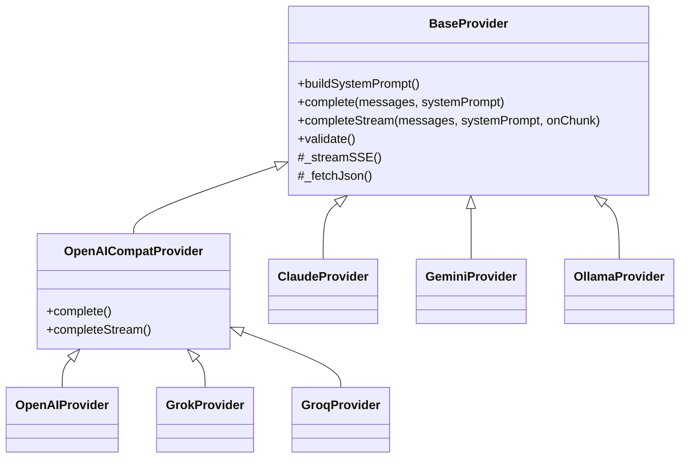
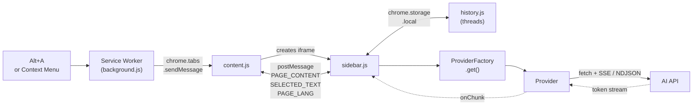

# Aside - Architecture

Technical documentation for contributors. For the user-facing description,
see [README.md](README.md).

---

## Provider System

- **Six AI providers** - Claude, Gemini, OpenAI, Grok, Groq, and Ollama; selected at runtime via `ProviderFactory`.
- **Shared OpenAI-compatible base** - `OpenAICompatProvider` implements the chat-completions wire format once; `OpenAIProvider`, `GrokProvider`, and `GroqProvider` are thin subclasses that set `url`, `model`, and the output-cap field their API expects.
- **Uniform message-array API** - every provider takes `(messages[], systemPrompt)`; the sidebar never branches on which class is running.

## Conversation & UI

- **Streaming responses** - token-by-token via SSE (`_streamSSE`) for OpenAI-style providers and NDJSON for Ollama; cancellable from the UI.
- **Multi-turn conversation history** - threads persisted to `chrome.storage.local` (5 MB), with an in-sidebar history panel, search, per-page filter, and restore.
- **Quick page actions** - one-tap chips for summarize / explain / key-points / translate / find on page, plus a curated prompt-template menu.
- **Bilingual UI (EN / HE)** - `translations.js` table + runtime `i18n.js` helper; UI flips RTL when Hebrew is active. Includes page-language auto-detection via `PAGE_LANG` message.
- **Per-provider model picker** - Settings page lets each provider keep its own selected model.

## Extension Platform

- **MV3 service worker** - `background.js` handles the `Alt+A` keyboard command, context-menu registration, and live `VALIDATE_KEY` requests with a 10-second `Promise.race` timeout.
- **Authenticated `postMessage` bridge** - because `content.js` shares the host page's origin, the sidebar iframe cannot trust messages by origin alone. `content.js` mints a random nonce, stores it in `chrome.storage.session` (unreadable by page scripts), passes the channel id through the iframe URL hash, and tags every message it posts *into* the iframe; the sidebar reads the same nonce and rejects anything without it. The reverse direction (iframe → content) is trusted by `event.source === iframe.contentWindow`, which page scripts cannot spoof. The nonce is never echoed back to the parent, so the page never observes it. AI responses are rendered through an HTML-escaping markdown pass; user/host text is escaped before it reaches `innerHTML`.
- **Local-only storage** - API keys and settings live in `chrome.storage.local` via `shared/store.js`; nothing uses `chrome.storage.sync`, so no data is synced to a Google account or any server. A one-time migration moves data left in `sync` by older versions into `local` and clears it.
- **Page content extraction** - `extractPageContent()` walks semantic selectors (`article`, `main`, `[role="main"]`, `.article-body`…), strips nav/chrome nodes, and truncates at 12 000 chars.
- **Live API-key validation** - Settings sends `VALIDATE_KEY` to the service worker, which instantiates the provider and calls `validate()` against the real API.
- **Custom Markdown renderer** - hand-rolled `renderMarkdown()` covers headings, bold/italic, code blocks, tables, and lists; the raw model text is HTML-escaped first (`escapeHtml()`), and only then does the renderer add its own markup, so model output can never inject HTML. There is no separate sanitizer.

---

## Class Hierarchy



## Runtime Flow



`ProviderFactory.get(name, apiKeys, selectedModels)` applies the **Strategy
pattern** - the sidebar calls `provider.completeStream(messages,
systemPrompt, onChunk)` with no knowledge of which class is running.
`OpenAIProvider`, `GrokProvider`, and `GroqProvider` reuse the entire
`OpenAICompatProvider` implementation by only declaring their endpoint URL,
default model, and output-cap field (`max_tokens` vs `max_completion_tokens`).
Per-model request hints (e.g. reasoning `effort`) and retired-model
redirects live in the catalog, `providers/models.js`. Switching providers requires a single
`chrome.storage.local` write.

## Project Layout

```
background.js              ← MV3 service worker
manifest.json              ← MV3 manifest (Alt+A command, context menu, options_ui)
_locales/{en,he}/          ← chrome.i18n message catalogs
content/                   ← page-injected content script + iframe host CSS
sidebar/
  sidebar.{html,css,js}    ← main chat UI
  history.js               ← thread storage layer
  i18n.js + translations.js← runtime UI translation
  action-config.js         ← page-action chip definitions
  prompt-templates.js      ← one-tap prompt presets
options/                   ← settings page (API keys, model picker, language)
popup/                     ← toolbar popup
providers/                 ← BaseProvider + 6 concrete providers + factory
  models.js                ← the model catalog: single source of truth for model ids
shared/
  store.js                 ← the only settings storage layer (chrome.storage.local)
  provider-marks.js        ← shared SVG provider monograms
site/                      ← landing page, deployed to GitHub Pages (see below)
scripts/                   ← model catalog checks, site build, release ZIP
marketing/                 ← images, README video renderer, Chrome Web Store assets
docs/                      ← this file, and the monthly model update runbook
```

## Landing site

`site/` is a static site with no build tooling beyond one Node script. It is
deployed to GitHub Pages by `.github/workflows/deploy-site.yml`.

- **Generated files.** `scripts/build-site.mjs` builds the Hebrew page
  (`site/he/index.html`), the static English text and JSON-LD, the "Latest
  models" chips, the "Updated <month>" badge and `site/demo/catalog.js` from
  two sources: the copy dictionary in `site/assets/i18n.js` and the model
  catalog in `providers/models.js`. CI runs it with `--check`.
- **Live demo.** `site/demo/demo.html` is a deterministic HTML animation:
  every frame is `renderAt(t)`. The landing page plays it in an iframe
  (`site/assets/demo.js` owns the clock; it is silent), and
  `marketing/demo/render.mjs` renders the same file to the README video.
- **Try it on the page.** `site/assets/try.js` opens a preview of the sidebar
  on the landing page itself (Alt+A or the hero button). Its answers are
  existing strings from the copy dictionary, labelled as a preview; it never
  calls a model and names no provider. It opens only on the visitor's action.
- **Step-by-step comparison.** `site/assets/race.js` plays the usual
  copy-paste routine next to the Aside way. It lists steps and claims no
  timings.

## Provider matrix

The built-in catalog lives in `providers/models.js` (the single source of truth).
Users can override the default per provider in Settings, or type any custom model
id - custom ids are remembered for reuse. The table below mirrors the catalog.

| Provider | Built-in default | Additional catalog models |
|---|---|---|
| **Claude** (Anthropic) | `claude-sonnet-5-5` | `claude-opus-5-5` · `claude-fable-5-2` · `claude-haiku-5-5` |
| **OpenAI** | `gpt-6-luna` | `gpt-6.1-terra` · `gpt-6.1-sol` · `gpt-6-astra` |
| **Gemini** (Google) | `gemini-3.5-flash-lite` | `gemini-3.8-flash` · `gemini-4-argon` |
| **Grok** (xAI) † | `grok-4.3` | `grok-4.20-0309-non-reasoning` · `grok-4.7` |
| **Groq** † | `openai/gpt-oss-120b` | `openai/gpt-oss-20b` |
| **Ollama** (local) | `qwen3.5` | `qwen3.5:4b` · `gemma4` · `gpt-oss:20b` · `llama3.2` · `llama3.1` · any locally pulled model |

<sup>† Grok, Groq, and OpenAI all extend `OpenAICompatProvider` - the chat-completions wire format is shared in one place.</sup>
